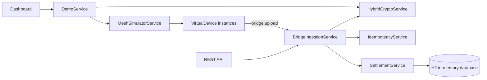

# Architecture and data flow

## System boundary

This repository contains a single Spring Boot application. It simulates the sender and the mesh in the same process; it does not contain a mobile client, Bluetooth implementation, external bank, NPCI integration, or remote bridge service.

## Payment path

1. `POST /api/demo/send` calls `DemoService`. The service creates a `PaymentInstruction` with sender, receiver, amount, a demo PIN hash, a random nonce, and the current timestamp.
2. `HybridCryptoService` serializes the instruction, generates a fresh AES-256 key and 12-byte IV, encrypts the instruction using AES-GCM, then wraps the AES key using the server's RSA public key and OAEP padding.
3. The server packages the Base64 ciphertext in a `MeshPacket` and stores it on `phone-alice`.
4. `POST /api/mesh/gossip` runs a simplified broadcast across all virtual devices. The simulator carries packet copies and uses packet IDs to avoid storing the same packet twice on a device.
5. `POST /api/mesh/flush` uploads packets held by devices marked as internet-enabled. In the seeded topology, only `phone-bridge` has internet.
6. `BridgeIngestionService` hashes the decoded ciphertext bytes with SHA-256 and tries to atomically claim the hash in an in-memory `ConcurrentHashMap`.
7. If claimed, the service decrypts the packet and checks whether `signedAt` is within the configured freshness window, allowing up to five minutes of clock skew into the future.
8. `SettlementService` loads both accounts, checks the sender's balance, changes the two balances, and writes a ledger row in a database transaction. The transaction table has a unique index on the packet hash; account entities use JPA optimistic versioning.

The `nonce` is included in the encrypted instruction but is not independently checked by the ingestion service. The process-local map and database constraint provide duplicate defenses for this demo; they are not a distributed idempotency system.

## Persistence and lifecycle

- H2 is configured as an in-memory database (`jdbc:h2:mem:upimesh`).
- Hibernate creates and drops the schema across application lifecycle.
- Demo accounts are seeded when the database has no accounts.
- Mesh packets, virtual-device state, the RSA key pair, and idempotency claims are held in process memory.
- Restarting the process loses all of the above and creates a new RSA key pair.
- Resetting the mesh clears mesh packets and idempotency claims only. It does not reverse database settlements.

## Main code areas

- `controller/ApiController.java`: JSON endpoints under `/api`.
- `controller/DashboardController.java`: serves the dashboard at `/`.
- `crypto/ServerKeyHolder.java`: generates an ephemeral 2048-bit RSA key pair at startup.
- `crypto/HybridCryptoService.java`: hybrid encryption, decryption, and ciphertext hashing.
- `model/`: account and transaction JPA entities plus packet/instruction records.
- `service/MeshSimulatorService.java`: seeded virtual devices, gossip, and bridge upload simulation.
- `service/BridgeIngestionService.java`: deduplication, decryption, freshness check, and settlement orchestration.
- `service/SettlementService.java`: transactional balance updates and ledger insert.
